

<h1 align="center">PioCut</h1>

<b>Scoți mai multe piese din fiecare coală.</b> 
Croire optimizată · desktop · offline

<a href="https://www.piocut.com">www.piocut.com</a> ·
<a href="https://piogrup.gumroad.com/l/piocut">Descarcă Demo</a> ·
<a href="https://www.piocut.com/demo/">Încearcă online</a> ·
<a href="https://www.piocut.com/#pret">Preț</a>

<b>RO</b> · <a href="#english">EN</a>

> Acest depozit este doar de prezentare. **Codul sursă nu este public.** Aplicația se descarcă de pe [www.piocut.com](https://www.piocut.com) sau [Gumroad](https://piogrup.gumroad.com/l/piocut).

PioCut îți dă planul de tăiere în câteva secunde, cu fibră, kerf, cant și tăiere de ghilotină. Pentru OSB, MDF, tablă, aluminiu și policarbonat. Nu doar dimensiuni: PioCut ține cont de felul în care tai cu adevărat.

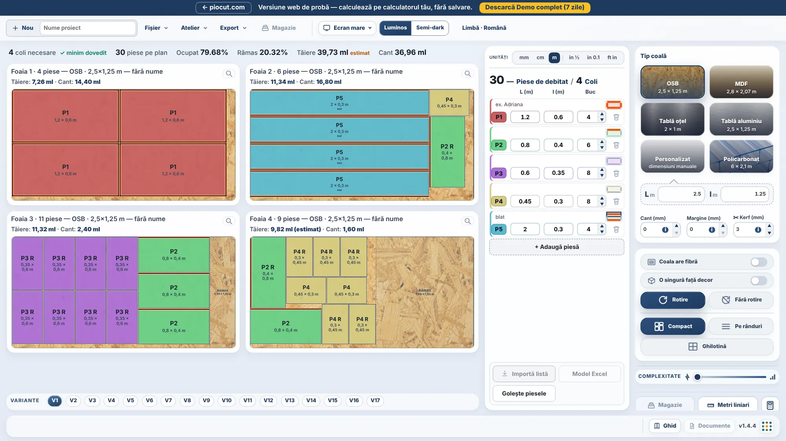

## Ce face

- **Optimizare automată.** Aranjează piesele pentru randament maxim și îți arată procentul ocupat pe fiecare coală.
- **Fibră · kerf · cant · margine.** Respectă direcția fibrei, grosimea pânzei, cantul și marginea colii, pe fiecare piesă.
- **Strategii de tăiere.** Compact, pe rânduri sau ghilotină, pentru ferăstrău cu pânză sau debitare liberă.
- **Mai multe materiale.** OSB, MDF, tablă de oțel și aluminiu, policarbonat, sau coală cu dimensiuni personalizate.
- **Variante de plan.** Compari V1…Vn și alegi varianta care ți se potrivește, cu un singur clic.
- **Export complet.** PNG, PDF, DXF și etichete: planul iese gata de atelier.
- **Planul, direct la ferăstrău.** Trimiți planul de croire pe un ecran din hală sau pe telefon, prin Wi-Fi. Omul care taie citește direct, fără hârtie.
- **Magazie.** Coli, resturi și jurnal de mișcări; stocul scade singur la tăiere, iar resturile noi intră în magazie.
- **Liste de piese din Excel, poză, PDF sau Word.** Tabelul se citește pe calculator, fără internet, iar ce e nesigur e marcat înainte să intre în listă.
- **Fața decor și piesele stânga / dreapta**, plus **tăiere în pachet** pentru fierăstraie cu grindă.
- **24 de limbi.**

**Materiale (coli standard):** OSB 2500×1250 · MDF 2800×2070 · tablă oțel 2000×1000 · tablă aluminiu 2500×1250 · policarbonat 6000×2100 · dimensiuni proprii.

## Cum arată

Aplicația reală, nu o machetă. Fiecare imagine e o captură din PioCut.

| | |
|---|---|
| 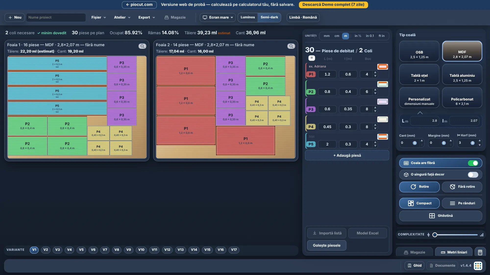 Fibră pe MDF · temă semi-dark |  Ghilotină: tăieturi de la un capăt la altul |
| 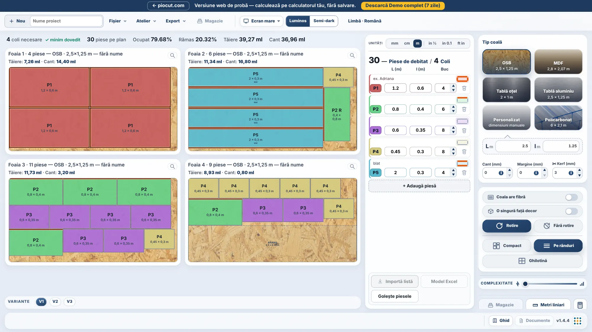 Pe rânduri: fâșii pe lungimea colii | 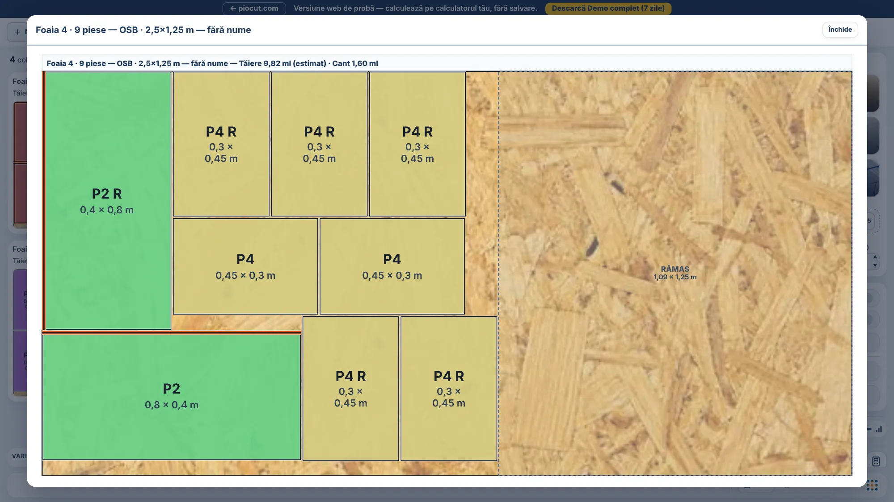 Zoom pe coală, cu restul utilizabil marcat |
| 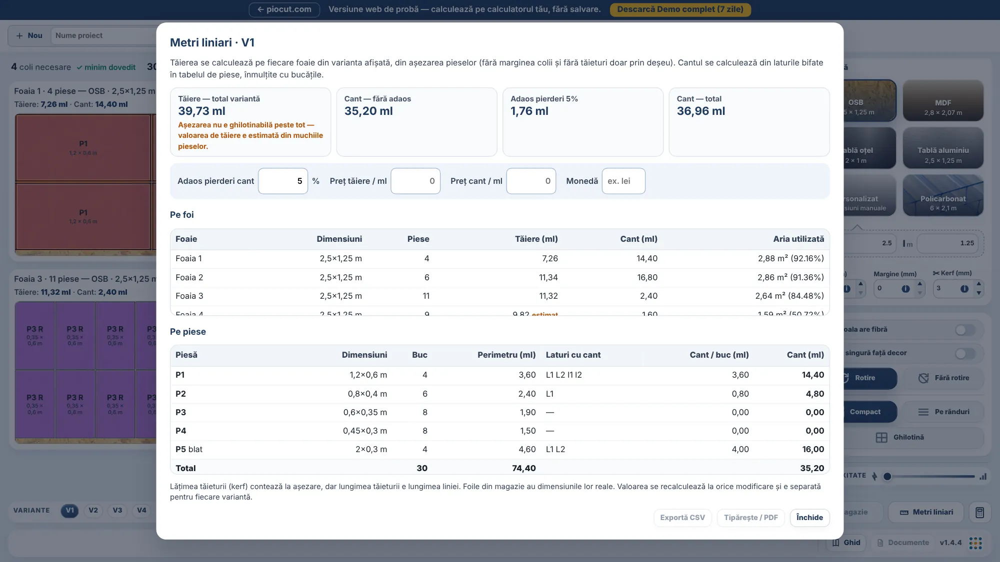 Metri liniari de tăiere și cant, cu cost | |

Un clip de un minut cu aplicația reală este pe [www.piocut.com](https://www.piocut.com).

## Încearcă

- **Demo gratuit, 7 zile**, cu toate funcțiile: [descarcă de pe Gumroad](https://piogrup.gumroad.com/l/piocut). Fără cont, fără card, funcționează offline. După 7 zile aplicația rămâne deschisă, dar unele funcții se blochează până la activare.
- **Proba online**, fără instalare: [www.piocut.com/demo](https://www.piocut.com/demo/). Scrii piesele (până la 30), compari variantele V1…Vn, schimbi Compact / Pe rânduri / Ghilotină și pornești fibra. Totul rulează în browserul tău, nimic nu se trimite și nimic nu se salvează.

## Preț

Plată unică, fără abonament. Licența e legată de calculator, o cheie per calculator. Prețuri orientative, TVA la plată.

| | Lite | Pro (recomandat) |
|---|---|---|
| Preț | **€69**, o dată | **€149**, o dată |
| Croire și optimizare, variante V1…Vn | ✓ | ✓ |
| Export PNG și PDF, toate materialele | ✓ | ✓ |
| Magazie: coli, resturi, jurnal de mișcări | ✓ | ✓ |
| Lungimea tăieturilor în metri liniari | ✓ | ✓ |
| Cant pe laturi, în metri liniari | | ✓ |
| Import liste (CAD), export DXF și etichete | | ✓ |
| Proiector + cast Wi-Fi în hală | | ✓ |
| Ciornă pe telefon (optimizare rapidă pentru piese puține) | | ✓ |
| | [Cumpără Lite](https://piogrup.gumroad.com/l/piocut-lite) | [Cumpără Pro](https://piogrup.gumroad.com/l/piocut-pro) |

Ai deja Lite? [Upgrade la Pro](https://piogrup.gumroad.com/l/piocut-upgrade), plătești doar diferența.

**Activare:** descarci aplicația o singură dată, trimiți Seria de Instalare (jos-dreapta) la office@piogrup.com, primești cheia și o lipești în PioCut. Cheia o transformă în Lite sau Pro, fără reinstalare.

## Manual

Manualul de utilizare, în 24 de limbi: [www.piocut.com/manual](https://www.piocut.com/manual/).

## Pentru atelierul tău

Ai un centru CNC, un fierăstrău cu grindă sau un fierăstrău vertical care primește comenzi într-un anumit format? Adaptăm exportul PioCut la mașina ta (CSV, XML, liste de tăiere, DXF pe straturi), plus etichete, plăci, resturi și prețuri predefinite. Personalizarea se ofertează pe proiect: [scrie-ne](mailto:office@piogrup.com?subject=PioCut%20%E2%80%94%20personalizare).

## Licență

Produs comercial. © 2026 Piogrup. Toate drepturile rezervate. Vezi [LICENSE](LICENSE). Folosirea aplicației este reglementată de [EULA](https://www.piocut.com/eula).

---

## English

> This repository is a showcase only. **The source code is not public.** Download the app from [www.piocut.com](https://www.piocut.com) or [Gumroad](https://piogrup.gumroad.com/l/piocut).

**Get more parts out of every sheet.** PioCut gives you the cutting plan in seconds, with grain, kerf, edge-banding and guillotine cuts. For OSB, MDF, metal, aluminium and polycarbonate. Desktop app, works offline.

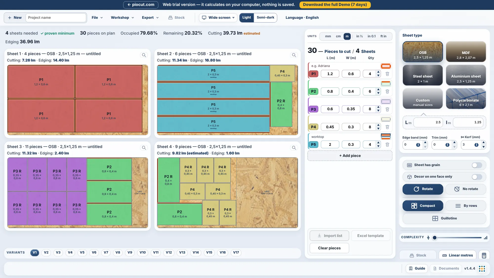

### Features

- **Automatic optimization.** Packs parts for maximum yield and shows the used percentage on every sheet.
- **Grain · kerf · edge-band · trim.** Respects grain direction, blade thickness, edge-banding and sheet trim, per piece.
- **Cutting strategies.** Compact, by rows or guillotine, for beam saws or free cutting.
- **Multiple materials.** OSB, MDF, steel and aluminium sheet, polycarbonate, or a custom-sized sheet.
- **Plan variants.** Compare V1…Vn and pick the layout that fits, with one click.
- **Full export.** PNG, PDF, DXF and labels: the plan comes out shop-ready.
- **The plan, straight to the saw.** Send the cutting plan to a screen in the workshop or to a phone, over Wi-Fi. The person cutting reads it directly, no paper.
- **Stock.** Sheets, offcuts and a movement log; stock goes down by itself when parts are cut, and new offcuts enter the warehouse.
- **Parts lists from Excel, a photo, PDF or Word.** The table is read on your computer, without internet, and anything uncertain is highlighted before it enters the list.
- **Decor face and left / right parts**, plus **book cutting** for beam saws.
- **24 languages.**

**Materials (standard sheets):** OSB 2500×1250 · MDF 2800×2070 · steel sheet 2000×1000 · aluminium sheet 2500×1250 · polycarbonate 6000×2100 · custom sizes.

### Screenshots

The real app, not a mock-up.

| | |
|---|---|
| 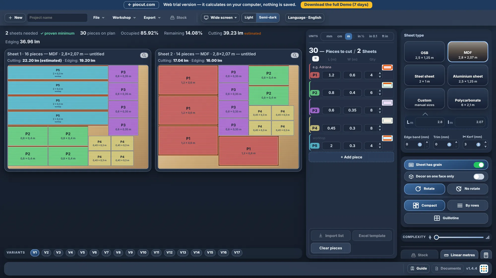 Grain on MDF · semi-dark theme | 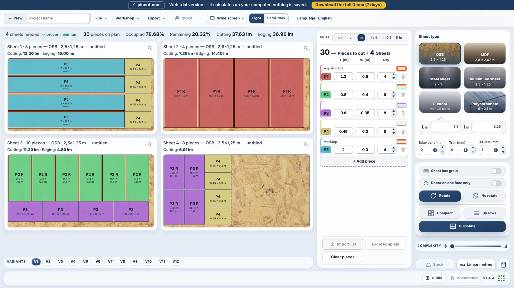 Guillotine: edge-to-edge cuts |
| 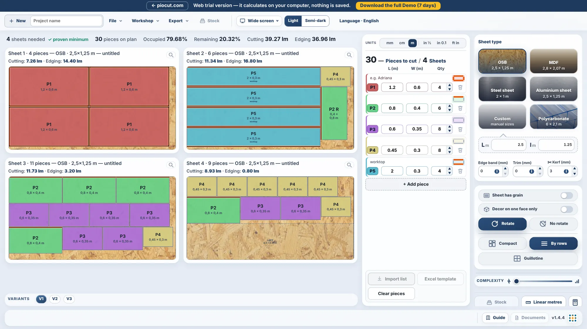 By rows: strips along the sheet | 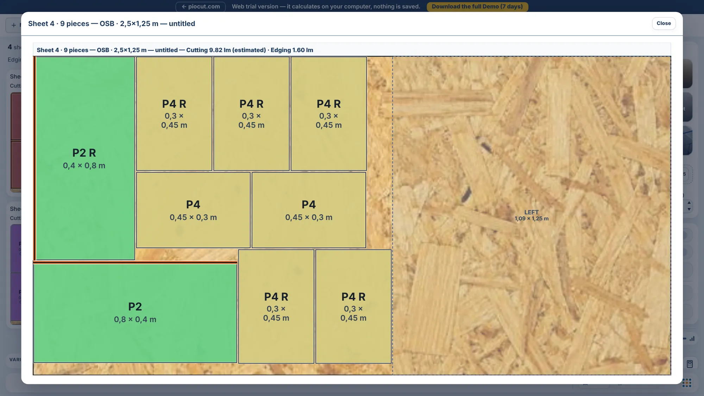 Sheet zoom, usable remnant marked |
| 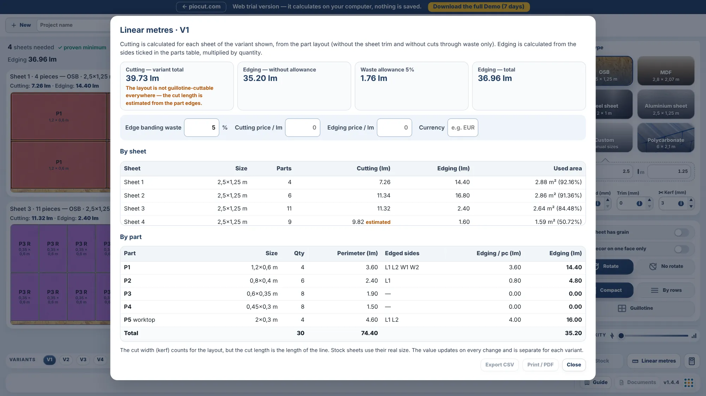 Linear metres of cutting and edging, with cost | |

A one-minute video of the real app is on [www.piocut.com](https://www.piocut.com).

### Try it

- **Free 7-day Demo**, all features: [download from Gumroad](https://piogrup.gumroad.com/l/piocut). No account, no card, works offline. After 7 days the app stays open, but some features lock until you activate.
- **Online trial**, no install: [www.piocut.com/demo](https://www.piocut.com/demo/). Type your parts (up to 30), compare variants V1…Vn, switch Compact / By rows / Guillotine and turn the grain on. Everything runs in your browser; nothing is uploaded and nothing is saved.

### Pricing

One-time payment, no subscription. The licence is tied to your computer, one key per machine. Indicative prices, VAT at checkout.

| | Lite | Pro (recommended) |
|---|---|---|
| Price | **€69**, once | **€149**, once |
| Cutting and optimization, variants V1…Vn | ✓ | ✓ |
| PNG and PDF export, all materials | ✓ | ✓ |
| Stock: sheets, offcuts, movement log | ✓ | ✓ |
| Cut length in linear metres | ✓ | ✓ |
| Edge-banding per side, in linear metres | | ✓ |
| List import (CAD), DXF and labels export | | ✓ |
| Projector + Wi-Fi cast to the shop | | ✓ |
| Scratchpad on phones (quick jobs for a few pieces) | | ✓ |
| | [Buy Lite](https://piogrup.gumroad.com/l/piocut-lite) | [Buy Pro](https://piogrup.gumroad.com/l/piocut-pro) |

Already on Lite? [Upgrade to Pro](https://piogrup.gumroad.com/l/piocut-upgrade) and pay only the difference.

**Activation:** download the app once, email your Installation Serial (bottom-right) to office@piogrup.com, get your key and paste it in PioCut. The key turns it into Lite or Pro, no reinstall.

### Manual

User manual in 24 languages: [www.piocut.com/manual](https://www.piocut.com/manual/).

### For your workshop

Do you have a CNC router, a beam saw or a vertical panel saw that takes jobs in its own format? We adapt PioCut's export to your machine (CSV, XML, cutting lists, layered DXF), plus labels, boards, remnants and prices preset in the app. Customisation is quoted per project: [write to us](mailto:office@piogrup.com?subject=PioCut%20%E2%80%94%20personalizare).

### Licence

Commercial product. © 2026 Piogrup. All rights reserved. See [LICENSE](LICENSE). Use of the app is governed by the [EULA](https://www.piocut.com/eula).
